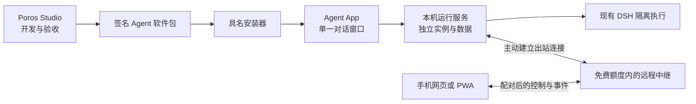

# Poros Agent 软件交付平台改造构想

> 此文保留方案形成时的设计与约束。2026-11-26 的实际实现、验证和外部条件以 [实施交付](AGENT_IDE_DELIVERY.md) 为准。

日期：2026-11-25。代码基线：`ad8211c9`。状态：设计方案，尚未实现安装器、独立运行时或新的远程中继；没有据此部署 Cloudflare 服务、安装软件或操作用户桌面。

当前修改范围、依赖顺序、逐项验收与暂停实施状态以 [AI IDE 修改方案](AGENT_IDE_IMPLEMENTATION_PLAN.md) 为准；本文件保留定位和软件交付构想。

目标是让 FDE 在 Poros 开发、验证和发布业务 Agent，最终向客户交付一个可以独立安装、运行、升级、卸载，并能从手机远程使用的软件。首个桌面目标为 Windows，手机先使用配套网页/PWA。后续平台遵循相同软件包协议，分别构建和验收。

## 0. 已明确的产品定位：专门开发 Agent 的 AI IDE

刘总进一步明确：Poros 是专门开发 Agent 的 AI IDE。开发主循环是“需求 → 修改真实工程 → 运行 → 查看轨迹与失败 → 修复 → 验收”，独立软件安装和远控是这个 IDE 的交付能力。下文的软件发行方案按此定位理解。

### 底座的五个模块

| 模块                 | 核心责任                                                                 | 必须留下的真实结果                                       |
| -------------------- | ------------------------------------------------------------------------ | -------------------------------------------------------- |
| IDE 工作区           | 打开工程、文件编辑、Diff、Git、终端；以开发对话为主入口                  | 用户能直接检查和接管实际文件及未提交变更                 |
| AI 开发引擎          | 读取工程、检索依赖、修改文件、执行获准命令、根据诊断迭代                 | 文件变更、实际命令、退出码、构建/测试结果                |
| Agent SDK 与运行内核 | 定义 Agent、工具、模型连接、会话状态、权限和产物；提供稳定运行入口       | 可在 IDE 调试、也能随发行包独立运行的同一实现            |
| Agent 调试与验收     | 对照源码版本查看模型调用、工具输入输出、状态、成本和失败；把案例纳入回归 | 关联源码快照与环境绑定的运行证据；未知或未运行不得判通过 |
| 构建与交付           | 解析工程依赖、绑定客户环境、打包、更新、安装、手机远控                   | 上文拟议的可携带包、安装产物、版本及设备权限             |

这五个模块首先是同一代码库的模块边界，不要求拆成五个微服务。IDE/CLI/桌面外壳调用同一 SDK 和运行入口，远控通道调用同一受授权的运行协议。

### 用户已明确的主界面：左对话、右实时预览、一个设置入口

刘总明确强调简洁易用。默认工作界面采用双栏，左侧开发对话，右侧正在开发的 Agent 软件的真实运行界面；右侧可切 PC / 手机视图。API、技能、MCP 等通过统一设置入口按需打开。此前五模块是实现边界，不映射为五个常驻页面。

```text
┌──────────────────────────────────────────────────┐
│ 当前 Agent                                  设置 │
├────────────────────┬─────────────────────────────┤
│ 开发对话           │ 电脑 / 手机     预览状态     │
│                    │                             │
│ 描述需求、补材料   │ 正在开发的软件实际界面      │
│ AI 简要报告进展    │ 可点击、输入、试用          │
│                    │                             │
│ 输入修改要求  发送 │                             │
└────────────────────┴─────────────────────────────┘
```

这是结构示意，不是已经实现或渲染的截图。双栏可拖动；代码、Diff、终端与执行轨迹在需要时展开，主界面不常驻管理导航、目录、任务表或配置表单。近期工程与切换工程通过名称附近的按需入口提供。

两种对话必须清楚命名：左侧“开发对话”修改实现，右侧“试用 Agent”运行当前实现。它们有独立会话和权限，右侧输入不会自动变成修改代码的指令。PC / 手机预览使用同一构建版本，切换展示尺寸时保留开发对话、文件和试用任务。手机视图不自动等同于原生 App 或实体设备验收。

#### 用户操作与反馈

| 情境     | 默认交互                                         | 真实状态要求                                                   |
| -------- | ------------------------------------------------ | -------------------------------------------------------------- |
| 首次进入 | 左侧描述要开发的 Agent，右侧等待首次可运行版本   | 无需先填写长表单；缺少模型连接时原地打开相应设置               |
| AI 修改  | 左侧简短呈现当前动作，可停止；详细文件与命令折叠 | 保留用户输入，记录实际文件变更和执行结果                       |
| 构建成功 | 右侧自动更新可运行预览                           | 预览绑定源码/构建版本，开发进度与运行结果分开                  |
| 构建失败 | 左侧说明错误并进入修复，右侧标明暂未更新         | 若保留旧预览，明确显示“上次成功版本”；不能把旧画面当本次已成功 |
| 用户试用 | 直接在右侧操作 Agent；把问题反馈到左侧继续修改   | 试用也执行实际权限和外部操作确认，预览本身不扩大权限           |
| 准备交付 | 开发对话中的交付动作打开简短打包确认             | 发布固定已验收版本；未验证项和阻塞如实展示                     |

#### 一个设置入口，区分开发环境与当前 Agent

设置采用可关闭的侧面板，关闭后回到原对话和预览，未发送输入不丢失。内容分两组：

- 开发环境：开发 AI 使用的 API 地址、密钥、模型及实际连接测试。
- 当前 Agent：运行模型、Kdocs/IMA/TinyFish 等连接、技能与 MCP 的添加/启停、必要配置和权限范围。

保存 Agent 配置同步到该工程的配置与版本；密钥保存在凭证存储，通过引用使用。保存成功、连接验证成功、能力实际调用成功分别记录，不能互相替代。MCP 配置须区分开发 AI 自己的工具与交付 Agent 的工具，避免配置到错误角色。涉及生效和重新试跑时在面板明确提示，不引入额外管理流程。

界面验收重点是：描述需求即可开始；修改后能辨认预览版本；电脑/手机切换不丢工作；设置可配置两类模型及 Agent 技能/MCP；失败原地可恢复。当前仅完成交互定义，尚未实现或运行界面测试。

### 工程是源，数据库保存索引与运行记录

每个 Agent 工程包含实际代码、提示词、工具实现、Skill/MCP 声明、依赖锁、连接槽位、权限清单、验收案例和发行配置。Git 与文件内容是源码的依据；数据库记录工程定位、运行、评测与发行索引。客户凭证和安装环境绑定独立保存，不写入工程或提交。

现有 Prisma `AgentProject` 只是 Agent 与业务 Project 的关联表，不能宣称它已实现 IDE 工程。真正的开发工作区需要新的明确对象，例如 `AgentWorkspace`、`SourceRevision`、`DevelopmentSession`，并与现有业务 Conversation/Task 区分。

### 开发 AI 与业务 Agent 的权限分别定义

- 开发 AI 可以在授权工程范围内读、检索、修改、构建和测试；变更不得覆盖用户尚未提交的工作。
- 业务 Agent 只得到软件声明和安装者授权的业务工具、模型与文件范围，不继承 IDE 文件修改、终端和发布权限。
- 可复用 DSH 引擎和工具 broker，但开发场景需要独立 workspace 工具及执行策略。现有默认禁用文件系统等能力的运行配置，尚不具备 AI IDE 开发能力。
- 工程构建和测试在受控开发环境执行，保存真实结果。不得通过把任意宿主 Shell 暴露给已发行 Agent 来完成开发功能。

### 一条开发链，两个运行环境

开发对话产生文件变更 → 固定源码/依赖/测试数据版本 → 使用 SDK 在隔离运行端试跑 → 返回结构化事件和产物 → AI 定位并修复 → 按选定验收集复测 → 固定已验收版本 → 构建安装包。

IDE 调试和客户安装使用同一 Agent 实现与运行契约；开发绑定与客户绑定分别配置并记录。构建前新增变更不能自动继承上一版本的通过结果。事件恢复只补发记录，不重放外部副作用；真正的断点、状态检查点和恢复执行需另行实现后验收。

### 复用与实施顺序的修正

通用文件编辑、Git、终端和语言能力优先复用成熟 IDE 底座。Theia 官方提供自定义桌面/云 IDE 的框架，是候选之一；具体外壳兼容性须做小范围验证后决定。核心 SDK、运行协议和软件包不依赖某一种编辑器。[Theia 官方文档](https://theia-ide.org/docs/)

Agent 专属调试至少覆盖真实调用轨迹、状态、测试案例和版本对比。LangSmith Studio 官方也将运行交互、轨迹、评测及状态调试作为 Agent IDE 能力；这里只借鉴能力边界，不声明已集成或复制这些功能。[LangSmith Studio](https://docs.langchain.com/langsmith/studio)

后续实施先打通“一句话需求 → 真实工程变更 → 真实试跑失败 → 修改 → 精准复测通过”的最小开发链；然后执行下文 U1/U2，证明同一 Agent 脱离 IDE 独立运行和跨网控制，再扩展安装生命周期与交付体验。开发闭环与独立运行共同决定底座，不先扩大平台管理页面。

当前仅记录定位和设计修正，尚未实现上述新增模块。

## 1. 最终产品形态

产品分为三个交付边界，客户日常只接触自己的 Agent App。

| 部分          | 使用者                       | 职责                                                                  | 与其他部分的关系                                            |
| ------------- | ---------------------------- | --------------------------------------------------------------------- | ----------------------------------------------------------- |
| Poros Studio  | FDE / Agent 开发者           | 通过对话开发 Agent 工程、适配工具、试跑客户案例、构建安装包、发布更新 | 开发与发行系统，不成为客户每次使用时必须在线的控制中心      |
| Agent App     | 客户                         | 一个具名业务软件：单一主对话、文件、结果、必要确认、设置、连接手机    | 带有自己的身份、数据空间和运行服务；不要求安装或登录 Studio |
| Remote Access | 客户及获得临时授权的维护人员 | 手机访问、事件恢复、任务控制、受控维护                                | 可替换的网络通道；Agent 执行与最终权限判定仍在客户运行端    |

示意交付物：`售后工单助手-Setup.exe`、`资料归档助手-Setup.exe`。这些是目标名称示例，不是已经生成的文件。

“独立安装”要求不同 Agent 有不同的应用 ID、名称、图标、快捷方式、数据目录、凭证范围和升级通道。它们可以复用同机已经验证的运行组件；安装过程自动处理依赖，用户不必先搭建整个 Poros 平台。

手机首版提供对应 Agent 的 PWA，按软件身份设置名称、图标与安装范围，支持用户添加到主屏幕。它是远程客户端，任务仍在安装了运行服务的电脑执行。原生 Android APK / iOS App 属于后续独立构建目标，不能把 PWA 交付写成已经开发了原生移动 App。

## 2. 两条用户路径

### FDE 开发与交付

1. 在 Studio 建立 Agent 工程，通过对话提供业务流程、样例、接口文档与验收要求。
2. 系统维护真实工程文件、工具实现和依赖；需要澄清的业务条件在当前对话中确认。
3. 在隔离环境试跑，查看结果、来源和失败案例；针对选定案例修改实现。
4. 把验收标准、测试结果、代码和依赖固定到发布版本。
5. 选择目标平台，构建具名安装包与可验证的软件包清单。
6. 客户安装并绑定自己的模型、业务账号、文件目录；FDE 不把自己的凭证交给客户。
7. 后续现场问题关联到原案例和版本，验证修复后生成软件更新。

### 客户使用与手机远控

1. 安装具名 Agent App；首次安装自动检查并准备运行组件。
2. 首次运行只处理必需项：模型/业务账号、工作目录及软件声明的权限。
3. 打开后直接进入这个 Agent 的对话，输入要求或添加材料。
4. 点击“连接手机”，手机扫码，本机确认配对。
5. 手机使用同一 Agent 的对话、文件结果和待确认事项。电脑端与手机端看到同一任务状态。
6. 用户可以撤销手机或维护人员的访问。窗口关闭后的后台行为在托盘中明确显示。

客户界面不显示 Agent 目录、Builder、组织 ID、运行中心或能力注册入口。代码、来源和执行细节按需打开。Studio 保留工程能力，但以一个开发对话作为主入口。

## 3. 当前底座可以复用什么

| 已有实现                                             | 改造后的用途                           | 必须处理的差异                                                       |
| ---------------------------------------------------- | -------------------------------------- | -------------------------------------------------------------------- |
| `web/src/views/work.tsx` 与结果、文件组件            | Studio 开发会话及 Agent App 的对话组件 | 按模式组合；运行版固定一个 Agent，移除发布/构建导航                  |
| `src/server/conversations.ts`、Task / Run / RunEvent | 软件内持续会话、任务记录和进度恢复     | 所有对象绑定安装实例；远程访问仍执行同样权限检查                     |
| `worker.ts`、`runner.ts`                             | 本机后台任务、取消、超时和运行证据     | 运行进程可独立启动；关闭窗口不等于终止后台任务                       |
| `dsh-runtime.ts`、受控工具/模型桥                    | 隔离执行和实时授权                     | 保留边界；用户选择的文件/API通过受控适配访问，不默认暴露宿主文件系统 |
| AgentVersion、`releases.ts`                          | 不可变软件发布版本、审核与回滚来源     | 增加真实代码、依赖闭包、平台产物及软件签名，不能只导出配置 JSON      |
| 能力注册与连接修订                                   | 安装后的工具注册和账号绑定             | 平台内部 ID 必须转为可携带内容；发布要求与客户安装绑定分开           |
| Judgment 与反馈                                      | 客户规则、失败证据和业务验收的一部分   | 增加可复现案例和版本回归；规则检查不自动等同于业务验收               |
| React PWA 与移动布局                                 | 手机远控页面                           | 提取传输适配，支持 WebSocket 中继及事件补发                          |

当前 PostgreSQL 队列使用行锁、advisory lock、事务及原生 SQL。首版保留 PostgreSQL 以减少语义重写，运行组件负责管理；本方案不承诺直接切 SQLite。桌面文件存储增加本地适配，Studio 可以继续使用 S3。

当前外部连接尚未通过真实账号的完整业务验收。软件化不会使这些连接自动变成已验证能力，实际安装交付仍须验证客户的真实模型和业务接口。

## 4. 一个 Agent 软件包包含什么

建议增加可携带的 `.poros-agent` 软件包协议。安装器、运行器和更新器使用同一包。下列目录是拟议契约，不是当前已实现格式。

```text
agent-bundle/
  manifest.json           软件身份、版本、目标系统、运行组件要求、入口
  app/                    Agent 实现、业务逻辑及锁定依赖
  capabilities/           工具、Skill、连接器的声明和固定实现
  resources/              图标、通用模板及明确允许发行的资源
  connection-schemas/     模型、业务账号、目录等安装期配置要求
  evaluations/            测试案例、验收标准和运行方法
  release-evidence/       构建和验收结果、来源版本
  sbom.json               依赖与许可证清单
  checksums.json          文件摘要
  signature               发布者签名
```

软件包不得夹带开发者 API Key、客户生产数据、私人文档或登录态。客户专有内容只在明确授权的定制发行范围内导出；下一客户默认复用通用实现和验收方法，重新绑定数据与接口。

现有 `poros-catalog:<id>`、知识文件引用及数据库中的授权记录不能直接搬进安装包。导出器必须解析依赖闭包，固定内容和摘要，生成本地可解析引用；缺少任何依赖时构建失败并明确缺项。

发行身份至少区分：

- App ID：软件的稳定身份。
- Release ID / digest：本次实现、依赖与权限要求的固定版本。
- Installation ID：客户机器上的一次安装。
- Deployment binding：此安装实际选用的模型、账号、工作区和许可范围。

## 5. 安装期绑定必须独立于开发者环境

当前个人模型授权会冻结具体端点和型号，受管能力引用平台登记项。独立发行需要新增第二版包契约：

1. 发布版本声明逻辑连接槽位、协议、必要模型能力及允许的权限范围。
2. 客户在首次安装时填入自己的实际端点、型号和凭证，确认实际访问范围。
3. 本机生成单独的部署绑定版本，固定实际连接与授权。
4. 每条任务同时固定软件版本和部署绑定，继续执行当前连接撤销与实时权限校验。
5. 凭证替换、范围扩大、连接失效分别产生清楚的状态，必要时重新确认和验证。

旧固定端点版本维持旧契约。新旧两种 manifest 显式区分；禁止通过放宽当前 `parseManifest` 或跳过授权检查来兼容软件包。

新包经 `resolveInstalledManifest` 解析后，生成当前执行层可使用的具体快照。兼容层须验证有效权限是软件声明与安装者授权的交集。开发期模型账号不进入发行包。

## 6. 独立运行与桌面安装路线

建议首版复用 Electron 桌面外壳、React 界面及固定 Node 运行组件。Electron 官方推荐使用 Electron Forge 等成熟工具完成打包和分发。[Electron 打包](https://www.electronjs.org/docs/latest/tutorial/application-distribution)



建议运行结构：

- 桌面外壳负责窗口、托盘、文件选择、手机配对与更新提示。
- Agent 服务负责会话、任务、鉴权、连接绑定和业务执行，与窗口进程分开。
- 同机运行组件可以复用程序文件与镜像；每个 Agent 使用独立数据空间、数据库身份和凭证范围。
- 自定义 Agent / 工具代码进入隔离执行环境，不作为 Electron 主进程或高权限宿主插件执行。
- 运行版 API 只注册当前软件需要的路由。隐藏管理导航不能代替服务端关闭 Studio 管理接口。

首版优先复用客户已有且合规的容器环境。没有容器环境的 Windows 电脑，单独验证 WSL2 + Linux Docker Engine 的托管运行组件方案，安装器负责准备和诊断。首次启用 WSL 可能需要管理员权限与重启；这必须在安装前清楚显示。[WSL 安装](https://learn.microsoft.com/en-us/windows/wsl/install)

不能把 Docker Desktop 宣传为适用于全部企业的永久免费依赖。官方免费条件包含个人、教育、非商业开源和符合规模条件的小企业，大型组织等用途可能需要付费。本方案要求免费运行组件路线通过独立技术验证，不通过时明确列出支持环境，不降低隔离直接在宿主执行任意代码。[Docker Desktop 许可](https://docs.docker.com/subscription-billing/desktop-license/)

为压低首版迁移量，本机运行组件先托管 PostgreSQL；每个 App 独立库/身份。文件存储提取接口，运行版使用受控本地目录，平台版保留 S3。不能让 App A 的凭证读到 App B 的记录、文件或模型配置。

这条复用路线的代价是首次依赖准备和磁盘/内存占用较大。可共享已验证的引擎、数据库服务、程序文件与镜像，避免每装一个 Agent 重复部署整个平台；各 App 的数据与权限仍独立。U1/U5 应记录首次下载体积、追加 Agent 的体积、冷启动时间和空闲内存，作为是否可接受的安装体验证据。若结果不能接受，再据实决定存储/运行组件精简，不能先宣称已经做到轻量安装。

安装必须包含自己的运行依赖或可靠依赖准备步骤，不能以“生成一个网页快捷方式”通过验收。开发平台关闭后，已安装 App 应继续工作。

## 7. 免费远程方案的选择

以下是截至 2026-11-25 的官方文档条件；实际网络、安装器和中继尚未验证。

| 方案                                               | 已核对的条件                                                                           | 方案中的定位                                                   |
| -------------------------------------------------- | -------------------------------------------------------------------------------------- | -------------------------------------------------------------- |
| Cloudflare Workers + SQLite-backed Durable Objects | 两者有免费额度；可用 WebSocket，DO 支持休眠；可用 workers.dev 免自购域名               | 零自购域名的默认候选；需要实现轻量中继并先验证免费额度内运行   |
| 正式 Cloudflare Tunnel                             | 现成连接器，发布公网应用需要接入 Cloudflare 的域名；账号和域名配置有前置条件           | 已有域名或客户自管域名时的直接 HTTP 通道，可复用当前 HTTP/SSE  |
| Cloudflare Quick Tunnel                            | 免账号、免域名；随机临时地址；200 个在途请求上限；不支持 SSE，没有可用性保证           | 临时演示和诊断，不作为稳定交付入口                             |
| Tailscale Serve / Funnel                           | 官方有 Personal 免费方案；当前为最多 6 用户，团队等场景按实际套餐；Funnel 提供公网入口 | 个人/小规模及已有 tailnet 的可选通道；不能承诺所有企业无限免费 |

来源：[Workers 计费](https://developers.cloudflare.com/workers/platform/pricing/)、[Durable Objects 计费](https://developers.cloudflare.com/durable-objects/platform/pricing/)、[WebSocket 与休眠](https://developers.cloudflare.com/durable-objects/best-practices/websockets/)、[workers.dev](https://developers.cloudflare.com/workers/configuration/routing/workers-dev/)、[正式 Tunnel](https://developers.cloudflare.com/cloudflare-one/networks/connectors/cloudflare-tunnel/get-started/create-remote-tunnel/)、[Quick Tunnel 限制](https://developers.cloudflare.com/tunnel/get-started/quick-tunnels/)、[Tailscale 套餐](https://tailscale.com/pricing)、[Funnel](https://tailscale.com/docs/features/tailscale-funnel)。

建议把远程协议做成可替换适配：默认候选为 Workers/DO 中继；客户已有正式 Tunnel 或私网时可以直接复用。免费路径首阶段未通过实际验证前，只能称为候选方案。

### 7.1 免域名中继的工作方式

1. 平台维护者或客户部署一份可自托管的 Relay 到自己的 Cloudflare 账号，配置 Relay 地址；不把账号管理 Token 放进安装包。
2. 安装端主动发起 WSS 出站连接，手机也连接 Relay，无需给客户路由器配置入站端口。
3. 每个安装端建立设备通道，同机多个 Agent 可复用连接，但每条请求必须携带并验证目标 App / 安装身份。
4. Relay 负责投递有界控制消息、任务事件和文件分片，业务执行、授权、完整记录在客户运行端。
5. 空闲连接使用 DO Hibernation，避免持续驻留；不在中继用高频定时器维持在线，不把每个字符单独发成一次消息。
6. 断线后按事件游标向本机运行端补发；副作用命令用幂等 ID 查询原回执，不自动重复执行。

这个 Relay 是传输层，不在 Cloudflare 上运行 DSH、大模型或客户业务代码。现有 SSE 在本地/直接 HTTP 模式保留；远程 Relay 模式通过统一事件客户端使用 WebSocket。

dsh-mobile 当前官方仓库说明，其控制与会话通道均使用 WebSocket，共享层维护协议和同步状态，可借鉴连接恢复与事件归并；它与 Poros 的任务协议不同，不能直接把其网关暴露为 Poros 授权入口。任何代码复用应固定版本并保留 MIT 许可。[dsh-mobile](https://github.com/Clarklevis1995/dsh-mobile)

### 7.2 免费的准确含义

Workers 免费方案当前包含每日 100,000 请求及每次调用 10ms CPU 等限制；DO 免费方案当前包含每日 100,000 计费请求、13,000 GB-s，以及存储读写限制。额度按账号共享，不是每个 Agent 自动得到一份。DO 计费规则包含 WebSocket 消息，具体折算以官方文档为准。

应保持 Free 计划、不自动切付费，设置保守的设备/速率/大小限制；额度耗尽时显示远程不可用并保留本地使用，禁止悄悄升级套餐。模型 API、计算机、电力、可选域名、系统代码签名与商店分发不属于免费转发承诺。

workers.dev 官方定位偏向个人/业余等非关键用途，推荐正式生产使用自有域名；Quick Tunnel 同样没有生产可用性保证。因此可以以免费额度验证和交付适用规模的远控能力，不能承诺永久无限量、企业级 SLA 或所有网络必然畅通。企业重要场景可复用已有域名、私网或自托管 Relay，仍然使用同一应用协议。

## 8. 远程控制的范围与权限

第一期“远程控制”明确指控制已安装 Agent：发任务、补充材料、看进度和结果、回答问题、确认操作、取消任务、暂停接收新工作与恢复。客户电脑必须在线，后台服务必须运行；电脑睡眠、关机或网络不可达时显示离线。

“暂停工作”保留连接守护，手机可以恢复；“彻底退出服务”会使远程不可用，不能承诺在电脑已离线时远程启动它。

| 访问者     | 拟议权限                                                                           |
| ---------- | ---------------------------------------------------------------------------------- |
| 查看者     | 看获授权的状态和结果，不提交操作                                                   |
| 操作者     | 使用本 Agent、提交材料、处理自己有资格的确认与取消                                 |
| 所有者     | 配对/撤销设备、配置连接、确认权限变化、批准软件更新                                |
| 临时维护者 | 所有者授予范围和期限，查看脱敏诊断、处理指定版本问题；不自动获得凭证读取或宿主控制 |

手机配对使用一次性短期邀请、本机确认与设备身份。邀请不能成为永久管理密码，普通 URL 不携带长期密钥。撤销设备和关闭远控后，本机授权应立即失效；Studio 的组织 JWT 不作为客户安装端通行证。

控制端、Agent 服务和中继都要区分 App ID / Installation ID / 会话 / 请求 ID。即使投递到了错误 Agent，接收端也拒绝执行。日志与回执从运行端产生，Relay 不生成业务成功结果。

首版中继使用经过认证的 TLS 通道，明确基础传输的信任边界，敏感凭证留在客户本机。若宣称中继不可读取业务内容，必须另外实现并验证应用层端到端加密；网页客户端仍需信任前端发布源，不能把“云端不落盘”当成端到端加密。

若 Agent 要操作宿主浏览器或桌面，另增经过本机授权的 Host Bridge，限定应用、目录和操作，作为独立专项验收。普通隧道不会自动提供桌面操作能力。首期不暴露宿主任意 Shell、Docker socket、RDP 或全盘文件接口。

## 9. 软件更新、维护与客户复用

- 当前任务固定原版本；升级先完成或明确结束活动任务，再切换新版本。
- 下载后验证发布者签名、内容摘要、目标平台与运行组件兼容性，验证失败不安装。
- 数据迁移前保留可恢复备份；只有数据契约兼容时才允许回滚，不能把数据库回滚当作改一个版本指针。
- 软件包签名与 Windows/macOS 公信代码签名分别管理。前者不等同于系统代码签名；分发渠道的签名要求和成本需真实配置，不能保证未签名安装器不会出现系统提示。
- 卸载某个 Agent 时停止它的任务、撤销远控并由用户选择保留或删除数据。共享运行组件仍被其他 Agent 使用时保留。
- FDE 维护权限由客户显式授予，可限时撤销；诊断默认脱敏。客户现场反馈进入工程的复现案例，测试通过后形成更新包。
- 客户 B 复用客户 A 项目中的通用实现和验收方法时，数据、凭证和客户专有业务规则重新核对，不能整库复制。

## 10. 建议新增的工程边界

以下为拟议目录和对象，不代表已有文件。

| 新增/调整部分        | 建议位置                                                         | 作用                                                         |
| -------------------- | ---------------------------------------------------------------- | ------------------------------------------------------------ |
| Agent 工程与代码版本 | `src/agent-project/`、Prisma 新实体                              | 从配置编辑扩展到真实实现、工具适配和验收集                   |
| 包协议与导出器       | `src/app-bundle/`                                                | 解析依赖闭包，校验无平台悬空引用，生成摘要、SBOM与签名       |
| 独立运行入口         | `src/runtime/`                                                   | 固定一个 Agent、安装所有者、局部 API、部署绑定、运行生命周期 |
| 存储适配             | `src/server/storage.ts` 与新 local 实现                          | Studio S3 / 本地 App 文件存储切换，保留路径与权限约束        |
| 桌面壳与构建         | `desktop/`、构建脚本和 CI                                        | 具名安装、托盘、启动、更新和卸载                             |
| 远控传输             | `src/remote/`、`relay/`                                          | 配对、路由、事件恢复、额度与连接状态                         |
| 运行版前端           | `web/src/runtime/`                                               | 复用对话/文件/结果组件，去掉平台管理流程                     |
| 客户端传输接口       | `web/src/api.ts` 与事件客户端                                    | Direct HTTP/SSE 和 Relay WebSocket 共用业务界面              |
| 软件交付实体         | AgentAppRelease、BuildArtifact、DeploymentBinding、TrustedDevice | 关联实现、安装包、安装环境及远程权限                         |

发布包版本与安装身份应增加到任务、审计和产物来源中。现有 Studio / API 不直接改成桌面独占实现，避免破坏已验证的平台用法。

## 11. 最小可验证实施单元

顺序以先验证最大不确定性、再扩展产品为原则。以下全部是后续实施计划，本轮没有执行这些测试。

| 单元                      | 目标及涉及文件                              | 执行动作                                                                                              | 验证与完成标准                                                                               |
| ------------------------- | ------------------------------------------- | ----------------------------------------------------------------------------------------------------- | -------------------------------------------------------------------------------------------- |
| U1 独立运行证明           | `app-bundle` / `runtime` 原型、隔离测试环境 | 从一个已批准版本解析全部必要依赖，在没有 Studio 服务/数据库访问的环境启动                             | Studio 断开后完成真实任务；错误或缺依赖明确失败；不使用开发者凭证                            |
| U2 免费远控证明           | `remote` / `relay` 原型、事件客户端         | 在明确的免费 Cloudflare 账号下连接电脑与手机，验证 WebSocket 休眠和事件恢复；同时评估已有 Tunnel 直通 | 跨网络真实控制、断线后不重复副作用、可撤销，记录实际额度/CPU/休眠；不把本地模拟当公网验收    |
| U3 工程与可携带发布       | `agent-project` / `app-bundle` / Prisma     | 保存实际代码、工具、连接槽位和验收案例，构建固定依赖的包                                              | 任一悬空平台 ID / 密钥泄漏 / 摘要不一致均拒绝发行；版本可追溯                                |
| U4 安装期绑定与本地存储   | `runtime` / `releases` / `storage` / auth   | 导入本地能力，绑定客户连接，建立独立库和数据目录                                                      | A/B 两 App 权限与数据互不泄漏；换钥撤销按现有边界生效；旧包兼容路径明确                      |
| U5 Windows 安装与生命周期 | `desktop` / 托管运行组件 / 构建流水线       | 生成真实具名安装器，完成首次依赖、启动、托盘、更新与卸载                                              | 干净受支持 Windows 环境实测；重启、升级、回滚、卸载不损坏另一个 App；管理员/重启要求如实显示 |
| U6 单窗口运行与手机配对   | `web/src/runtime` / API 与事件客户端        | 固定当前软件身份，完成文件、结果、确认、取消、手机二维码和设备撤销                                    | 用户不选择 Agent/项目/组织即可开始；手机与电脑看到同一真实任务，越权控制被拒绝               |
| U7 FDE 真实交付闭环       | 工程、验收集、安装包、客户授权环境          | 选择一种业务工作，交付一次、记录现场纠正、做软件更新，再适配第二环境                                  | 真实模型/接口完成业务验收；记录交付工时、返工与复用范围；不以技术测试数替代场景价值          |

U1/U2 是决策门槛：不能独立运行，或免费远控在目标网络和额度内不可用时，先解决原因再扩展界面。WSL 运行组件也是 U1/U5 的实际验证项，当前未承诺适用于所有 Windows 环境。

## 12. 最终验收剧本

1. 在 Studio 开发“资料归档助手”和另一款 Agent，生成两个真实安装包。
2. 在干净、受支持的 Windows 环境分别安装，有独立图标、应用 ID和版本。
3. 关闭 Studio，客户绑定自己的连接和目录后，本机完成真实任务。
4. 手机使用蜂窝网络扫码配对，提交材料、查看进度、处理确认并下载结果。
5. 模拟手机断网和连接重建，原任务仅执行一次，历史可补回。
6. 撤销手机后，它不能再次操作；一个 Agent 的会话凭证不能访问另一个 Agent。
7. FDE 获得限时维护权限，修复一条真实失败案例，回归通过后生成升级。
8. 更新时保留记录和连接，不在活动任务中间悄悄替换实现；不兼容的数据回滚被拦截。
9. 卸载一个 Agent，另一个继续工作；数据删除须遵从用户的卸载选择。
10. 真实查看免费账号的用量和失败行为；没有自动开启付费或把自购域名费用隐藏在免费承诺里。

完成这些步骤后，才可以交付“Agent 独立软件与免费额度内远控”。当前已有 80 项 API、PC/PWA 和隔离测试仅属于原底座证据，不算上述新形态已经验收。

## 13. 本次设计依据与限制

已读取当前 README、架构、移动部署、Prisma、发布与模型绑定、数据库/存储、队列和客户端请求代码，并核对本文件所列官方资料。Context7 当前返回无效 API key，技术资料改查官方文档。没有执行第三方安装脚本或新依赖代码。

主要风险是发行依赖闭包、运行组件安装体验、客户连接适配、隔离边界迁移，以及免费中继在真实网络和负载下的稳定性。先证明两个 App 可独立安装并完成手机控制，再增加开发平台功能。新增的数据、UI、包协议、安装器和中继均为方案，不是已实现成果。
